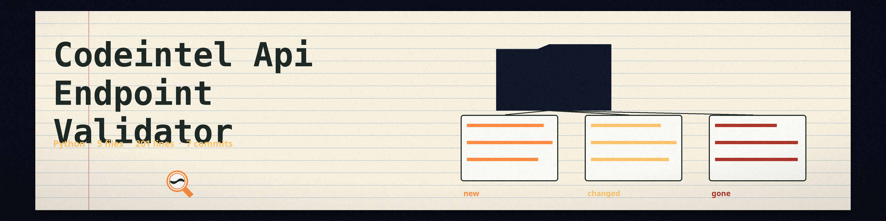

# codeintel-API-Endpoint-Validator
Scans a codebase for defined API endpoints and validates them against a defined schema (e.g., OpenAPI/Swagger). Detects endpoint definitions written as route, get, post, put, delete, or patch decorators on app, blueprint, router, or similar objects, checks each collected endpoint path against the schema paths and their method keys, and flags inconsistencies between the collected endpoints and the schema. The tool makes no judgement about whether an endpoint is a vulnerability or a misconfiguration. A code path that does not exist exits 1, and each run logs how many files were scanned and how many endpoints were checked.

## Install
`git clone https://github.com/ShadowStrikeHQ/codeintel-api-endpoint-validator`

## Usage
`./codeintel-api-endpoint-validator [params]`

## Parameters
- `-h`: Show help message and exit
- `-v`: Enable verbose logging.

## License
Copyright (c) ShadowStrikeHQ
