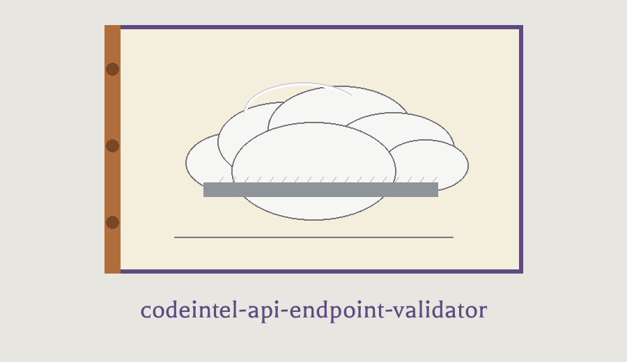
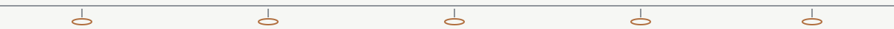
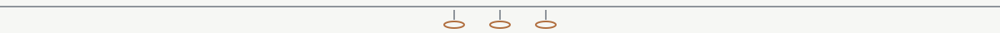

# codeintel-API-Endpoint-Validator

Scans a codebase for defined API endpoints and validates them against a defined schema (e.g., OpenAPI/Swagger). Detects endpoint definitions written as route, get, post, put, delete, or patch decorators on app, blueprint, router, or similar objects, checks each collected endpoint path against the schema paths and their method keys, and flags inconsistencies between the collected endpoints and the schema. The tool makes no judgement about whether an endpoint is a vulnerability or a misconfiguration. A code path that does not exist exits 1, and each run logs how many files were scanned and how many endpoints were checked.

> **Logbook marginalia: a closing slash is a different path.** Each collected path is compared as an exact string, so a route written with a closing slash and a schema path written without one are reported as different.

## Install
`git clone https://github.com/ShadowStrikeHQ/codeintel-api-endpoint-validator`

> **Logbook marginalia: clone line flagged.** The install line above points to ShadowStrikeHQ, not to ShadowGuard-AI. It is preserved as printed and flagged here, not quietly corrected. The repository also carries a requirements.txt naming PyYAML, a step the README does not give.

## Usage
`./codeintel-api-endpoint-validator [params]`

> **Logbook marginalia: usage line flagged.** The usage line above is a placeholder. The parser in main.py requires two positional arguments, a code path and a schema path, with -v available after them.

## Parameters
- `-h`: Show help message and exit
- `-v`: Enable verbose logging.

> **Logbook marginalia: the README omits both paths.** The parameter list above lists only -h and -v. The two positional paths the run cannot start without, the code path and the schema path, are supplied only in these flagged notes, never inserted into the preserved list as if the README had contained them.

## License
Copyright (c) ShadowStrikeHQ

> **Logbook marginalia: copyright line flagged.** The closing line above reads Copyright (c) ShadowStrikeHQ, preserved as printed. The repository LICENSE file carries the MIT License.
